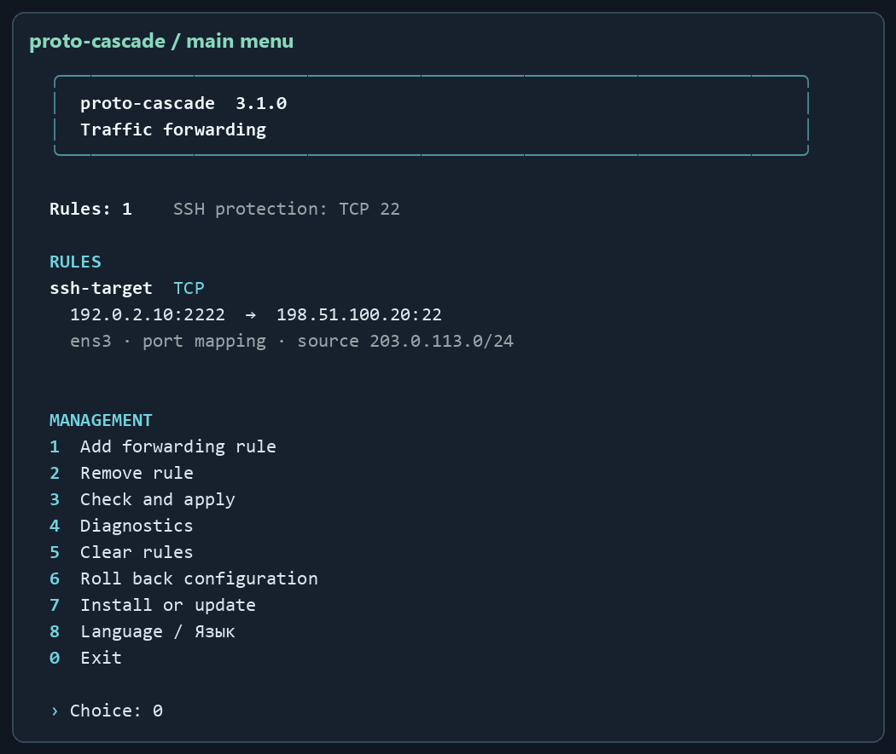
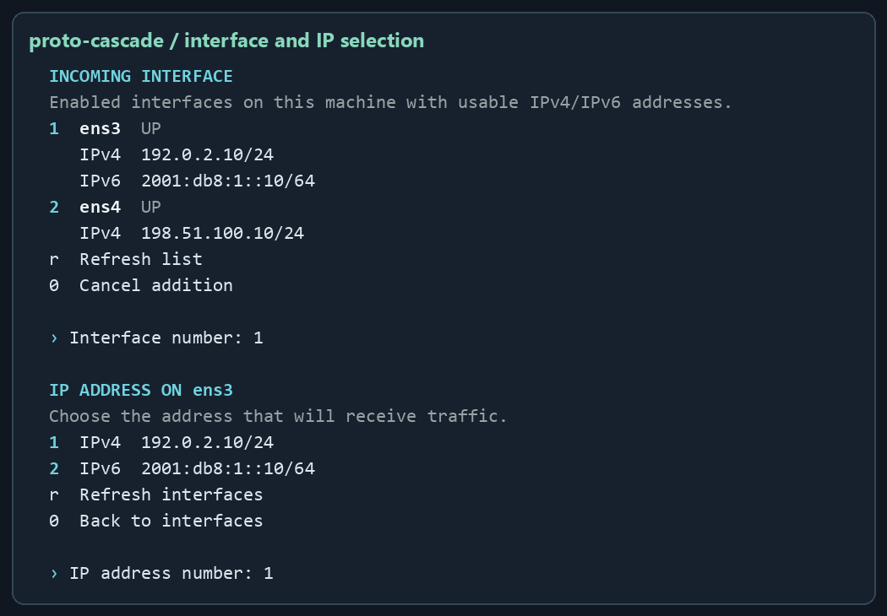

# proto-cascade

[Русский](README.ru.md) · [Installation](docs/INSTALLATION.md) · [User guide](docs/USER-GUIDE.md) · [Troubleshooting](docs/TROUBLESHOOTING.md)

**IPv4/IPv6 traffic forwarding for Linux with an English or Russian console and Docker-aware iptables rules.** Choose a local interface and IP address, specify the destination machine, and review the forwarding rule before adding it.

Version **3.1.0** · [MIT](LICENSE) · [Upstream attribution](UPSTREAM-NOTICE.md)



The illustrations use actual program formatting with synthetic documentation addresses. They are console previews, not network-test evidence.

## What it does

- Discovers usable local interfaces and IPv4/IPv6 addresses for numbered selection.
- Forwards TCP, UDP, TCP+UDP, SCTP, DCCP, ICMP/ICMPv6, GRE, ESP, AH, numeric IP protocols and all protocols, subject to the documented protocol restrictions.
- Maps ports, restricts client source networks, and uses MASQUERADE or preserves the client address when return routing is configured.
- Preserves Docker published-port priority and manages its own firewall chains.
- Protects configured gateway SSH ports while permitting mappings such as `2222 → another machine:22`.
- Checks generated rules before applying them and restores owned state after failed updates; keeps one previous configuration for rollback.
- Installs a systemd service and a reconciliation timer. The standalone installer includes all runtime code and its MIT notice.

## Requirements

Ubuntu **24.04** or Debian **12+**, Bash, Python **3.11+**, iptables/ip6tables, iproute2 and systemd. Installation and firewall operations require root. Ubuntu 24.04 is the validation platform; Debian is a compatibility target without a separate complete test matrix.

Supported Docker backend: **iptables**, including iptables-nft. Active UFW/firewalld, native Docker nftables and conflicting legacy installations cause the operation to stop. The installer uses apt to install missing Python, iptables and iproute2 on supported Debian-based systems.

## Install

```bash
git clone https://github.com/mrPortnov/proto-cascade.git
cd proto-cascade
sudo bash install-proto-cascade.sh --install
sudo proto-cascade
```

You can also [download only the installer](https://raw.githubusercontent.com/mrPortnov/proto-cascade/main/install-proto-cascade.sh), inspect it and transfer it to another VM. Run `sudo bash install-proto-cascade.sh --install` there; the project folder is not a runtime dependency. Use a pinned commit when you need an exact source version.

Choose **8 Language / Язык** in the menu to save English or Russian. For English in a single invocation, run `sudo proto-cascade --lang en`. The default is Russian until a language is saved.

Existing installations under the old product name need the [migration procedure](docs/MIGRATION.md) first.

## First rule

1. Open `sudo proto-cascade` and select **1**.
2. Enter a rule ID, choose the incoming interface, then choose its local IP.
3. Enter the remote destination, protocol, allowed source network and any port mapping.
4. Review the result and confirm `yes` in English or `да` in Russian. The default declines the change.



Example: forward SSH to another machine. Replace every documentation address and `eth0` with your actual values:

```bash
sudo proto-cascade add --id ssh-target --interface eth0 \
  --listen 192.0.2.10 --target 198.51.100.20 --protocol tcp \
  --in-port 2222 --out-port 22 --source 203.0.113.0/24
ssh -p 2222 user@192.0.2.10
```

The CLI `add` command applies immediately. Interactive addition asks for confirmation. Gateway SSH remains on its protected port; the destination still performs SSH authentication.

## Update and manage

From your repository clone:

```bash
git pull --ff-only
sudo bash install-proto-cascade.sh --install
```

The installer replaces the installed command and systemd units while retaining configuration and its previous backup. Menu item **7** reinstalls the version in the running file; obtain the updated source first to install a newer version.

```bash
sudo proto-cascade --list
sudo proto-cascade --check
sudo proto-cascade --diagnose
sudo proto-cascade rollback
```

Configuration: `/etc/proto-cascade/rules.json`. Installed command: `/usr/local/bin/proto-cascade`. Services: `proto-cascade.service` and `proto-cascade-reconcile.timer`. See [installation, update and removal](docs/INSTALLATION.md), [all menus and commands](docs/USER-GUIDE.md), and the [JSON example](examples/rules.example.json).

## Operational limits

The program configures forwarding; destination routes, sshd, DNS and Docker remain administrator responsibilities. Preserved source addresses require return routing through the gateway. AH authentication is incompatible with NAT address changes. IPv6 extension-header numbers are restricted. Layer 2 traffic is outside scope, and a supported IP protocol rule does not certify every VPN application. Switching tables/families is not one atomic kernel transaction; see the [guide](docs/USER-GUIDE.md).

The repository includes unit tests and an isolated Linux packet test. CI checks real IPv4/IPv6 packets against simulated Docker chains; this does not certify every Docker daemon version. Installation, update and reboot were additionally checked on a disposable Ubuntu 24.04 VM. See [changes](CHANGELOG.md) and [security reporting](SECURITY.md).

On two Ubuntu 24.04 QEMU VMs, we verified the upgrade from 3.0.0 to 3.1.0 with Docker Engine 29.9.2 (`iptables-nft`) and three running containers. TCP and UDP forwarding, SSH `2222 → 22`, and an `ssh -L` tunnel worked over IPv4 and IPv6. Published Docker ports kept priority when forwarding rules used the same ports.

This is an unofficial reimplementation originating from [anten-ka/kaskad](https://github.com/anten-ka/kaskad). The upstream MIT declaration and the absence of a full upstream license file in the audited revision are documented in [UPSTREAM-NOTICE.md](UPSTREAM-NOTICE.md).
