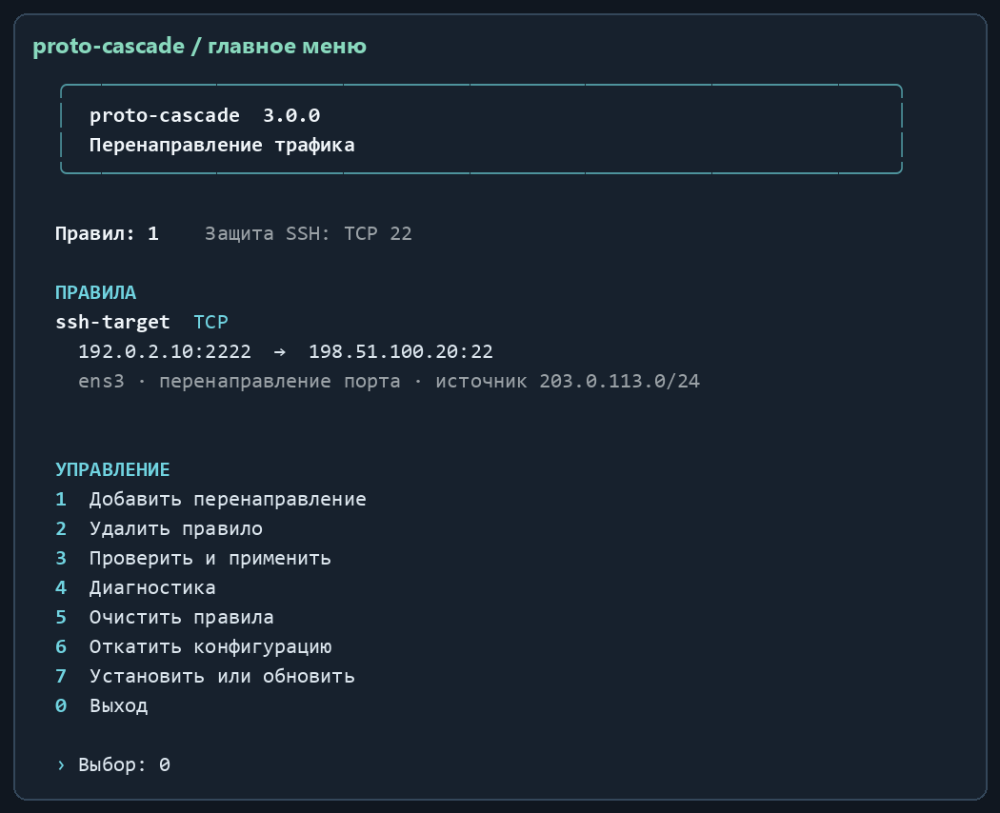
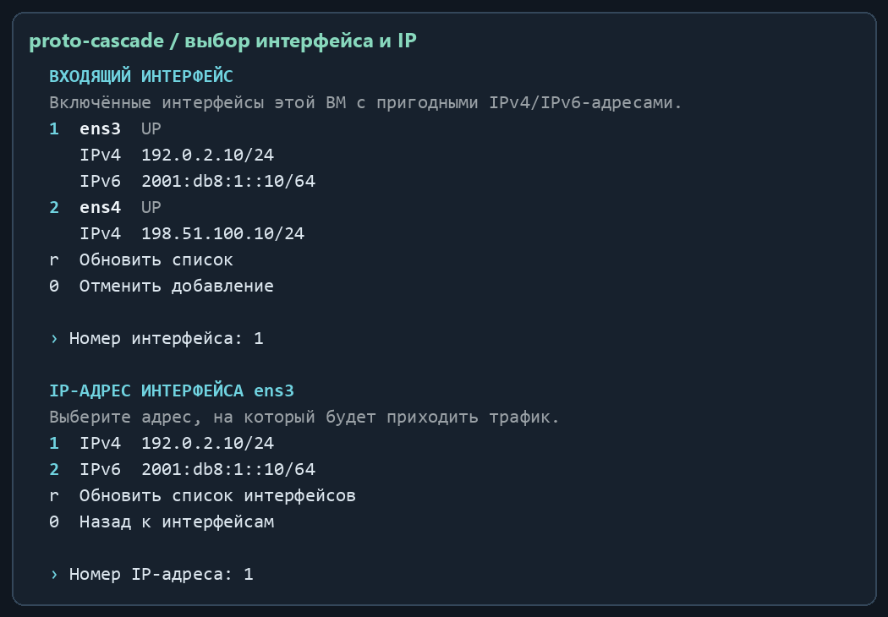

# proto-cascade

[English](README.md) · [Установка](docs/INSTALLATION.ru.md) · [Руководство](docs/USER-GUIDE.ru.md) · [Решение проблем](docs/TROUBLESHOOTING.md)

**Переадресация IPv4/IPv6 для Linux: русское консольное меню и правила iptables с учётом Docker.** Выберите локальный интерфейс и IP-адрес, укажите другую машину и проверьте правило перед добавлением.

Версия **3.0.0** · [MIT](LICENSE) · [Происхождение и атрибуция](UPSTREAM-NOTICE.md)



Иллюстрации сформированы из вывода программы с демонстрационными адресами. Это примеры консоли, а не доказательство сетевых испытаний.

## Возможности

- Автоматическое определение пригодных интерфейсов и IPv4/IPv6 с выбором по номеру.
- TCP, UDP, TCP+UDP, SCTP, DCCP, ICMP/ICMPv6, GRE, ESP, AH, числовые IP-протоколы и все протоколы с учётом описанных ограничений.
- Замена портов, ограничение сети клиентов, MASQUERADE или сохранение адреса клиента при настроенном обратном маршруте.
- Сохранение приоритета опубликованных портов Docker и управление собственными цепочками firewall.
- Защита настроенных SSH-портов шлюза с возможностью переадресации `2222 → другая машина:22`.
- Проверка генерируемых правил до применения и восстановление собственного состояния при сбое; одна предыдущая конфигурация для отката.
- Служба systemd и таймер восстановления подключений. Самостоятельный установщик содержит весь runtime-код и уведомление MIT.

## Требования

Ubuntu **24.04** или Debian **12+**, Bash, Python **3.11+**, iptables/ip6tables, iproute2 и systemd. Установка и операции с firewall требуют root. Проверки выполнялись на Ubuntu 24.04; Debian является целью совместимости без отдельной полной матрицы испытаний.

Поддерживается Docker с backend **iptables**, включая iptables-nft. Активные UFW/firewalld, нативный nftables backend Docker и конфликтующая старая установка приводят к остановке операции. На поддерживаемых Debian-подобных системах установщик использует apt для установки недостающих Python, iptables и iproute2.

## Установка

```bash
git clone https://github.com/mrPortnov/proto-cascade.git
cd proto-cascade
sudo bash install-proto-cascade.sh --install
sudo proto-cascade
```

Можно [скачать только установщик](https://raw.githubusercontent.com/mrPortnov/proto-cascade/main/install-proto-cascade.sh), изучить его и перенести на другую ВМ. На ней выполните `sudo bash install-proto-cascade.sh --install`; папка проекта для дальнейшего запуска не нужна. Для получения точной версии используйте ссылку на конкретный коммит.

Перед переходом с прежнего названия продукта выполните [инструкцию миграции](docs/MIGRATION.md).

## Первое правило

1. Откройте `sudo proto-cascade` и выберите **1**.
2. Введите ID правила, выберите входящий интерфейс, затем его локальный IP.
3. Укажите адрес другой машины, протокол, разрешённую сеть клиентов и при необходимости порты.
4. Проверьте результат и подтвердите `да`. Ответ по умолчанию — `нет`.



Пример переадресации SSH. Замените все демонстрационные адреса и `eth0` своими значениями:

```bash
sudo proto-cascade add --id ssh-target --interface eth0 \
  --listen 192.0.2.10 --target 198.51.100.20 --protocol tcp \
  --in-port 2222 --out-port 22 --source 203.0.113.0/24
ssh -p 2222 user@192.0.2.10
```

Команда CLI `add` применяет правило сразу. Интерактивное добавление запрашивает подтверждение. SSH самого шлюза остаётся на защищённом порту; целевая машина продолжает проверять авторизацию SSH.

## Обновление и управление

В своей копии репозитория:

```bash
git pull --ff-only
sudo bash install-proto-cascade.sh --install
```

Установщик заменяет установленную команду и unit-файлы, сохраняя конфигурацию и предыдущую резервную копию. Пункт **7** меню повторно устанавливает версию из запущенного файла; для новой версии сначала получите обновлённый исходный файл.

```bash
sudo proto-cascade --list
sudo proto-cascade --check
sudo proto-cascade --diagnose
sudo proto-cascade rollback
```

Конфигурация: `/etc/proto-cascade/rules.json`. Установленная команда: `/usr/local/bin/proto-cascade`. Службы: `proto-cascade.service` и `proto-cascade-reconcile.timer`. См. [установку, обновление и удаление](docs/INSTALLATION.ru.md), [все меню и команды](docs/USER-GUIDE.ru.md) и [пример JSON](examples/rules.example.json).

## Ограничения эксплуатации

Программа настраивает переадресацию; маршруты другой машины, sshd, DNS и Docker остаются ответственностью администратора. Для сохранения адреса клиента нужен обратный маршрут через шлюз. AH не совместим с изменением адресов NAT. Для номеров заголовков расширения IPv6 действуют ограничения. Трафик второго уровня не обрабатывается; поддержка правила IP-протокола не означает проверку каждого VPN-приложения. Переключение таблиц/семейств не является одной атомарной транзакцией ядра; подробности — в [руководстве](docs/USER-GUIDE.ru.md).

В репозитории есть модульные тесты и изолированный сетевой тест Linux. CI проверяет реальные IPv4/IPv6-пакеты с имитируемыми цепочками Docker; это не сертификация каждого daemon Docker. Установка, обновление и перезагрузка дополнительно проверялись на одноразовой ВМ Ubuntu 24.04. См. [изменения](CHANGELOG.md) и [сообщение об уязвимостях](SECURITY.md).

Это неофициальная переработка, происходящая от [anten-ka/kaskad](https://github.com/anten-ka/kaskad). Указание MIT в upstream и отсутствие полного файла лицензии в проверенной версии описаны в [UPSTREAM-NOTICE.md](UPSTREAM-NOTICE.md).
