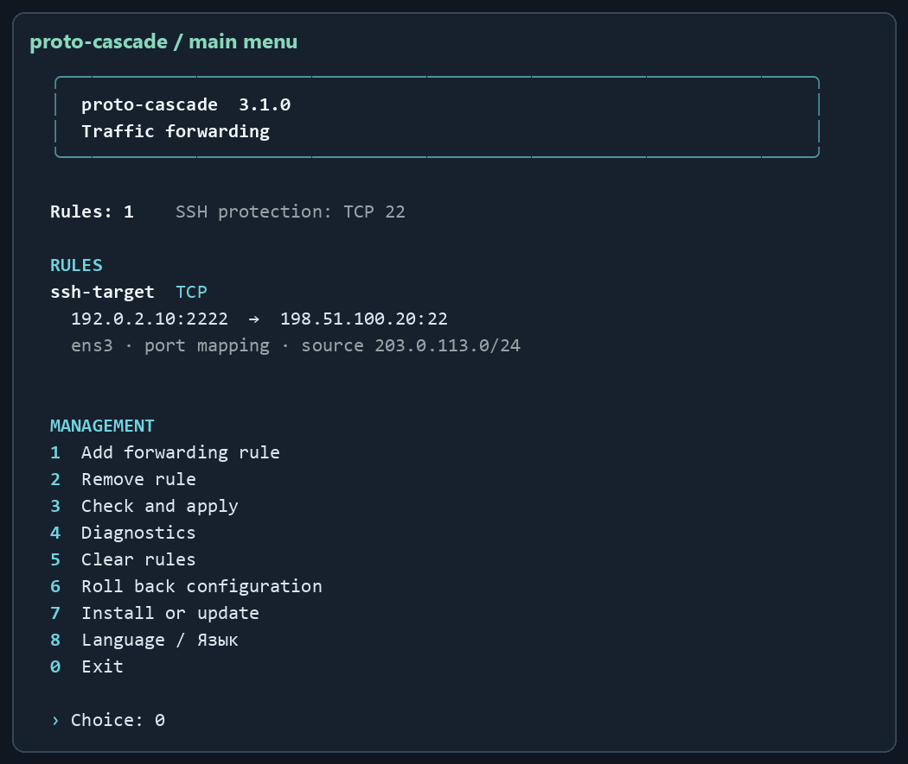
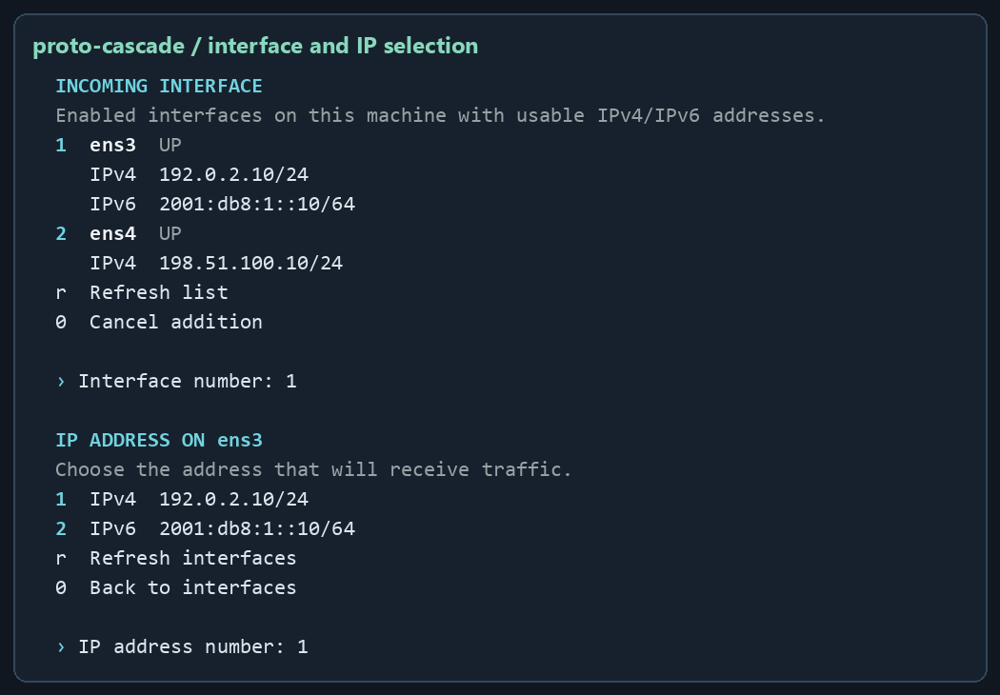
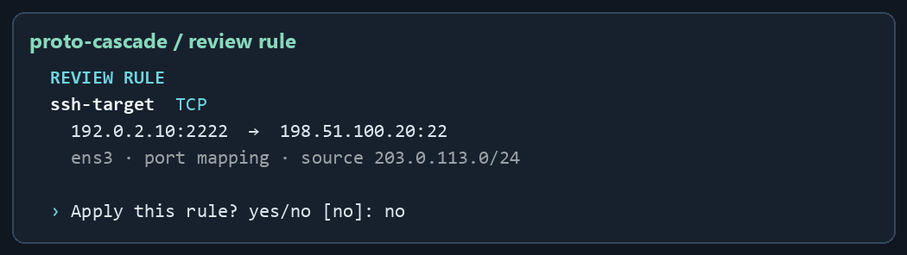

# User guide

[Русский](USER-GUIDE.ru.md) · [Installation and update](INSTALLATION.md) · [Troubleshooting](TROUBLESHOOTING.md)

## Connection flow

A client connects to the gateway's `listen` address. A rule selects the incoming interface, IP, protocol, source network and optional port, then DNAT forwards the connection to another machine, `target`. With `snat: masquerade`, that machine sees the gateway's outgoing-interface address. With `snat: none`, the client address is preserved and replies must be routed back through the gateway.

For example, a client in `203.0.113.0/24` connects to `192.0.2.10:2222`, and the gateway forwards it to `198.51.100.20:22`. All addresses in this guide are documentation examples. The rule does not create an SSH account or replace destination authentication.

## Main menu

```bash
sudo proto-cascade
```



The menu starts in Russian until you save a preference. Choose option **8**, then **2** for English or **1** for Russian. To override the saved language for one invocation, place `--lang en` or `--lang ru` before the command.

| Item | Action and confirmation |
| --- | --- |
| `1` | Enter the ID, interface, local IP and destination settings. Review the rule and confirm `yes` or `да`. The default declines the change. |
| `2` | Delete by ID. Entering an existing ID applies deletion immediately; an empty answer cancels. |
| `3` | Check and apply the current configuration immediately. Preflight is part of the operation; there is no separate confirmation. |
| `4` | Show configuration, backend, forwarding, owned chains and service state. |
| `5` | Clear owned rules after typing `DELETE` in English or `УДАЛИТЬ` in Russian. |
| `6` | Show the previous configuration and apply it after answering `yes` or `да`. |
| `7` | Install/reinstall the command and units from the running file, then apply saved configuration. |
| `8` | Choose the interface language and save it on this machine. |
| `0` | Exit. |

The menu requires an interactive terminal. Use CLI commands in automation or when redirecting input. Color is enabled in terminals; passing `NO_COLOR=1` to the process disables it. Use a UTF-8 terminal with Cyrillic and Unicode-box support.

## Interface and IP selection



The inventory comes from `ip -j address show` on this machine. Enabled interfaces with usable addresses are listed. `lo`, names beginning `docker`, `br-`, `veth`, loopback, link-local, multicast, IPv4-mapped IPv6, tentative/DAD-failed, deprecated and expired addresses are excluded. Private IPv4 and IPv6 ULA are allowed.

- Enter the **number** of the interface and then its IP; these values need no manual typing in the menu.
- With one option, Enter selects it.
- `r` refreshes interfaces and addresses.
- `0` on the IP screen returns to interfaces; `0` on the interface screen cancels addition.
- `listen` must be assigned to a local interface. A VM behind NAT may not own the external router's public IP; forwarding on that router is a separate requirement.
- Enter the remote destination separately, in the same address family. It must not be one of the gateway's own addresses. Targets inside Docker bridge networks are outside the manager's scope.

## Add and review a rule

The ID is unique and contains 1–32 ASCII letters, digits, `_` or `-`. Select a protocol, source network and optional port mapping. For port-based protocols, an empty incoming port means all ports of that protocol. Restrict the allowed client network with `source`.



Confirmation validates JSON, local addresses/interfaces, routes, conflicting managers and generated kernel rules. Fix reported errors before retrying. A route existing does not prove the destination service is reachable; test from an actual client.

## CLI commands

CLI operations that change rules apply without an interactive question. `clear` requires the explicit `--yes` flag.

| Command | Purpose |
| --- | --- |
| `sudo proto-cascade` | Menu. |
| `sudo proto-cascade --lang en --list` | Display this invocation in English. The flag goes before the command. |
| `sudo proto-cascade language en` | Save English for future administrative invocations. Use `ru` to save Russian. |
| `proto-cascade --version` | Print the installed version. |
| `sudo proto-cascade --install` | Reinstall the running version and apply configuration. |
| `sudo proto-cascade --list` | Show configuration. |
| `sudo proto-cascade --check` | Environment and `iptables-restore --test` preflight without applying rules. |
| `sudo proto-cascade --apply` | Apply saved JSON. |
| `sudo proto-cascade --diagnose` | Diagnostics. |
| `sudo proto-cascade --reconcile` | Check and repair owned chains/hooks when needed. |
| `sudo proto-cascade remove ID` | Delete and apply. |
| `sudo proto-cascade clear --yes` | Clear owned rules and save an empty list. |
| `sudo proto-cascade rollback` | Apply the previous configuration. |
| `bash install-proto-cascade.sh plan --file FILE` | Print generated rules offline, without root or network changes. |
| `bash install-proto-cascade.sh --help` | General help; use `add --help` for add options. |

`install`, `list`, `check`, `apply`, `diagnose` and `reconcile` also work without `--`.

```bash
sudo proto-cascade add --id ssh-target --interface eth0 \
  --listen 192.0.2.10 --target 198.51.100.20 --protocol tcp \
  --in-port 2222 --out-port 22 --source 203.0.113.0/24 --snat masquerade

sudo proto-cascade remove ssh-target
```

## JSON configuration

The main file is `/etc/proto-cascade/rules.json`. Schema version **2** is separate from product version **3.1.0**. See the complete [example](../examples/rules.example.json).

```json
{
  "version": 2,
  "protected_tcp_ports": [22],
  "rules": [{
    "id": "ssh-target",
    "interface": "eth0",
    "listen": "192.0.2.10",
    "target": "198.51.100.20",
    "protocol": "tcp",
    "in_port": 2222,
    "out_port": 22,
    "source": "203.0.113.0/24",
    "snat": "masquerade"
  }]
}
```

| Field | Requirement |
| --- | --- |
| `version` | Number `2`. |
| `protected_tcp_ports` | Gateway management TCP ports; retain every gateway SSH port when editing. |
| `rules` | At most 500 rules with unique IDs. Overlapping selectors are rejected. |
| `interface`, `listen` | Existing interface and an assigned unicast address. |
| `target` | Another machine in the same address family, with a route outside a Docker bridge. |
| `protocol` | `tcp`, `udp`, `tcp+udp`, `sctp`, `dccp`, `icmp`, `icmpv6`, `gre`, `esp`, `ah`, `all`, or a supported number 1–255. |
| `in_port`, `out_port` | TCP/UDP/SCTP/DCCP or TCP+UDP. Without `out_port`, the incoming port is retained. Omit both for non-port protocols. |
| `source` | Same-family CIDR; default `0.0.0.0/0` or `::/0` permits all family sources. |
| `snat` | Default `masquerade`, or `none` with return routing configured. |

For manual editing:

```bash
sudo cp -a /etc/proto-cascade/rules.json /root/proto-cascade-rules.manual-backup.json
sudoedit /etc/proto-cascade/rules.json
sudo proto-cascade --check
sudo proto-cascade --apply
```

Replace example addresses before using the JSON. Editing a file directly does not itself create a new `rules.previous.json`; keep a separate backup before manual edits.

## SSH and protocols

SSH protection exempts incoming gateway TCP ports listed in `protected_tcp_ports` from owned forwarding, including broad rules. It is not sshd hardening, authentication or fail2ban configuration. First installation considers 22, the current SSH port from the environment if sudo preserved it, and ports reported by `sshd -T` when that command is available. Verify the resulting list, particularly for custom SSH ports.

`2222 → target:22` is allowed when 2222 is not a protected gateway management port. SSH `-L`, `-R` and `-D` use an established SSH connection: the manager forwards its transport, while SSH creates the tunnel.

ICMP is IPv4; ICMPv6 is IPv6. IPv6 extension-header numbers 43, 44, 59 and 60 are not accepted as transport protocols; use an appropriate `all` rule. AH authentication cannot survive NAT address changes. ESP/GRE/SCTP/DCCP rule validation does not certify a particular VPN/application. ARP and other Layer 2 traffic are outside scope.

## Docker and recovery

Docker's iptables backend, including iptables-nft, is supported. Published Docker ports take priority over broad manager rules. Owned DNAT hooks follow Docker DNAT; the owned FORWARD chain is also reached through DOCKER-USER when present. Your rule applies where the selected listen address/port is not claimed by a Docker published port.

The timer checks roughly every 45 seconds and repairs owned hooks after changes. A Docker restart can leave an interval until the next check; run `sudo proto-cascade --reconcile` to request it explicitly. An overlapping operation receives a busy-lock error; retry after the running operation finishes. Active UFW/firewalld, another firewall backend and conflicting legacy managers are not disabled automatically.

All generated tables/families receive preflight checks. A failed update restores owned rules and changed sysctl values. Linux does not provide a single atomic transaction covering all tables/families, so switching can have a brief interval. Foreign chains and global conntrack are not flushed.

## Performance

Version 3.1.0 skips redundant DNAT guards for explicit port mappings. With 500 TCP+UDP mappings and a match at the end of the chain, the median round-trip time for a new UDP flow on Ubuntu 24.04 in QEMU went from 5.68 to 5.42 ms for IPv4 and from 8.31 to 5.99 ms for IPv6. These figures are medians of three runs per version in Linux network namespaces. TCP throughput varied across runs. Results depend on the host, the rules and their order. The installer enables the IP forwarding needed by the configured rules and leaves system-wide performance tuning to the administrator.

## Rollback and clearing

`rules.previous.json` stores **one** previous configuration when the manager saves changes. `rollback` validates and applies it; it is not a version archive. Changed interfaces/routes can require editing the backup before restoration.

`clear --yes` saves an empty rule list, removes owned hooks and leaves empty owned chains. Services and files remain. Shared IP forwarding is not automatically turned off because Docker or other services may need it. See [complete removal](INSTALLATION.md#removal).
