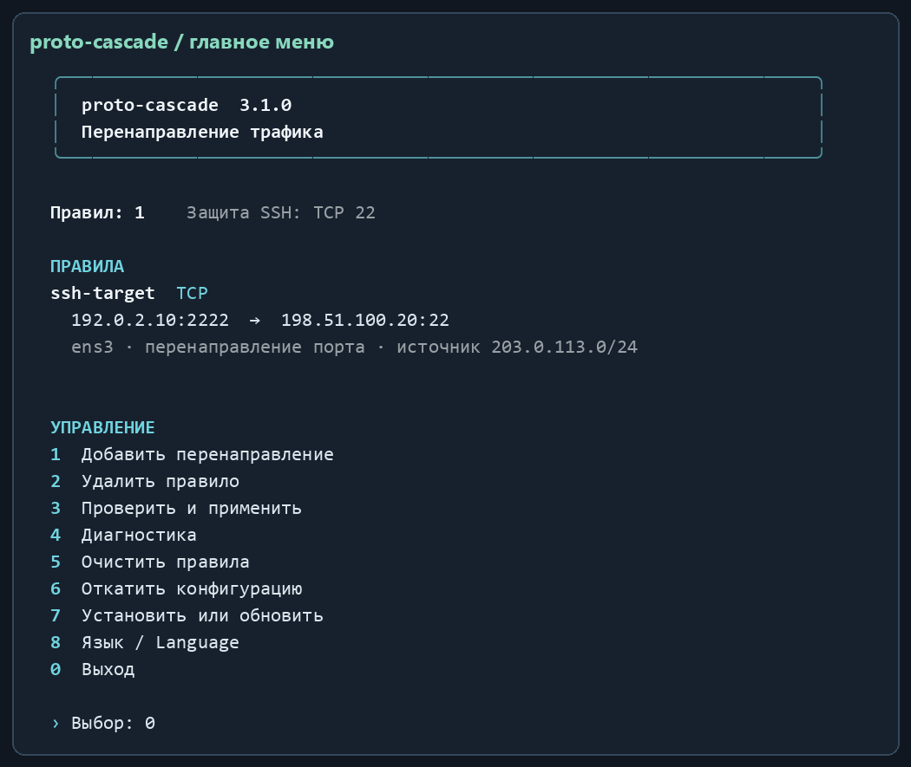
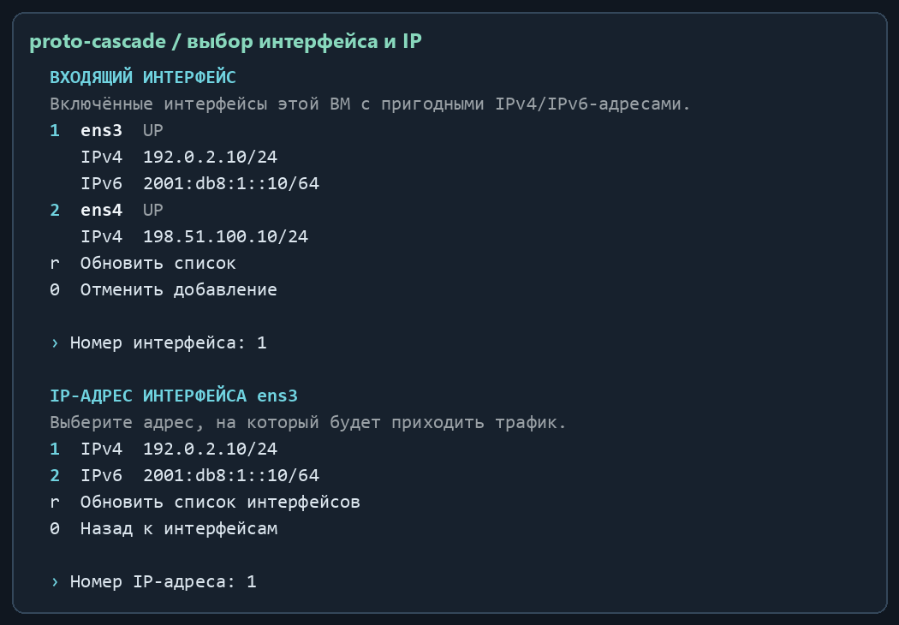
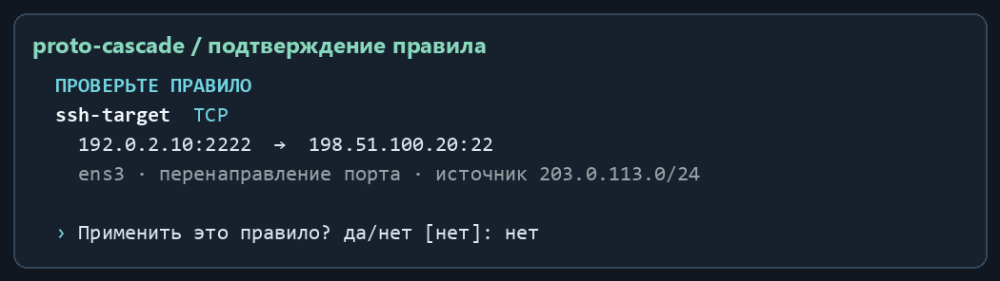

# Руководство пользователя

[English](USER-GUIDE.md) · [Установка и обновление](INSTALLATION.ru.md) · [Решение проблем](TROUBLESHOOTING.md)

## Как проходит соединение

Клиент обращается к адресу шлюза `listen`. Правило выбирает входящий интерфейс, IP, протокол, сеть клиента и при необходимости порт, затем выполняет DNAT на другую машину `target`. При `snat: masquerade` адрес клиента заменяется адресом выходного интерфейса шлюза. При `snat: none` он сохраняется, а обратный маршрут на целевой машине должен проходить через шлюз.

Например: клиент из `203.0.113.0/24` подключается к `192.0.2.10:2222`, шлюз отправляет соединение на `198.51.100.20:22`. Все адреса в этом руководстве демонстрационные. Правило не создаёт пользователя SSH и не заменяет авторизацию целевой машины.

## Главное меню

```bash
sudo proto-cascade
```



До сохранения предпочтения меню открывается на русском. В пункте **8** выберите **1** для русского или **2** для английского. Флаг `--lang en` или `--lang ru` перед командой меняет язык на один запуск.

| Пункт | Действие и подтверждение |
| --- | --- |
| `1` | Ввести ID, интерфейс, локальный IP и параметры назначения. Проверить правило и подтвердить `да` или `yes`. По умолчанию изменение отменяется. |
| `2` | Удалить правило по его ID. После ввода существующего ID удаление применяется сразу; пустой ввод отменяет действие. |
| `3` | Проверить и применить текущую конфигурацию сразу. Предварительная проверка входит в операцию; отдельного вопроса перед применением нет. |
| `4` | Показать конфигурацию, backend, forwarding, собственные цепочки и состояние служб. |
| `5` | Очистить свои правила после ввода `УДАЛИТЬ` в русском интерфейсе или `DELETE` в английском. |
| `6` | Показать предыдущую конфигурацию и применить её после ответа `да` или `yes`. |
| `7` | Установить/переустановить команду и службы из запущенного файла, затем применить сохранённую конфигурацию. |
| `8` | Выбрать язык интерфейса и сохранить его на этой машине. |
| `0` | Выйти. |

Меню требует интерактивного терминала. При работе из скрипта или через перенаправление ввода используйте CLI. Цвет включается в терминале; `NO_COLOR=1 sudo -E proto-cascade` позволяет передать настройку отключения цвета, если политика sudo это допускает. Нужен терминал UTF-8 с поддержкой кириллицы и рамок Unicode.

## Выбор интерфейса и IP



Список читается с этой машины через `ip -j address show`. Программа показывает поднятые интерфейсы с пригодными IPv4/IPv6. Исключаются `lo`, имена `docker*`, `br-*`, `veth*`, loopback, link-local, multicast, IPv4-mapped IPv6, адреса с неудавшимся/незавершённым DAD, deprecated и истёкшие адреса. Частные IPv4 и IPv6 ULA допустимы.

- Введите **номер** интерфейса, затем номер его IP; вводить эти значения вручную в меню не требуется.
- Если вариант один, Enter выбирает его.
- `r` обновляет список интерфейсов и адресов.
- `0` на экране IP возвращает к интерфейсам; `0` на экране интерфейсов отменяет добавление.
- `listen` — адрес, назначенный локальному интерфейсу. Если ВМ находится за NAT, внешний адрес роутера может отсутствовать в списке; на внешнем роутере дополнительно требуется перенаправление на ВМ.
- Адрес другой машины вводится отдельно. Он должен иметь то же семейство IP и не быть адресом самого шлюза. Цель в Docker bridge-сети не поддерживается: менеджер предназначен для других машин.

## Добавление и просмотр правила

ID — уникальные 1–32 латинские буквы, цифры, `_` или `-`. Выберите `tcp`, `udp`, `tcp+udp` или другой поддерживаемый протокол. Для портовых протоколов можно указать входящий и целевой порты; пустой входящий порт означает все порты выбранного протокола. Ограничивайте сеть клиентов значением `source`.



При подтверждении программа проверяет JSON, адреса/интерфейсы, маршруты, конфликтующие менеджеры и генерируемые правила ядра. Если проверка не прошла, исправьте указанную причину. Существование маршрута не доказывает доступность службы на назначении — проверьте соединение с реального клиента.

## Все команды CLI

CLI-команды, меняющие правила, действуют без интерактивного подтверждения. Исключение — обязательный флаг `--yes` у `clear`.

| Команда | Назначение |
| --- | --- |
| `sudo proto-cascade` | Открыть меню. |
| `sudo proto-cascade --lang en --list` | Показать вывод этого запуска на английском. Флаг указывается перед командой. |
| `sudo proto-cascade language en` | Сохранить английский для следующих административных запусков. Для русского укажите `ru`. |
| `proto-cascade --version` | Показать установленную версию. |
| `sudo proto-cascade --install` | Переустановить текущую запущенную версию и применить конфигурацию. |
| `sudo proto-cascade --list` | Показать конфигурацию. |
| `sudo proto-cascade --check` | Проверить окружение и `iptables-restore --test`, без применения правил. |
| `sudo proto-cascade --apply` | Применить сохранённый JSON. |
| `sudo proto-cascade --diagnose` | Диагностика. |
| `sudo proto-cascade --reconcile` | Проверить и при необходимости восстановить собственные подключения/цепочки. |
| `sudo proto-cascade remove ID` | Удалить правило с указанным ID и применить. |
| `sudo proto-cascade clear --yes` | Очистить свои правила и сохранить пустой список. |
| `sudo proto-cascade rollback` | Применить предыдущую конфигурацию. |
| `bash install-proto-cascade.sh plan --file FILE` | Показать генерируемые правила офлайн, без root и изменения сети. |
| `bash install-proto-cascade.sh --help` | Общая справка; для параметров добавления используйте `add --help`. |

`install`, `list`, `check`, `apply`, `diagnose` и `reconcile` также принимаются без `--`.

```bash
sudo proto-cascade add --id ssh-target --interface eth0 \
  --listen 192.0.2.10 --target 198.51.100.20 --protocol tcp \
  --in-port 2222 --out-port 22 --source 203.0.113.0/24 --snat masquerade

sudo proto-cascade remove ssh-target
```

## JSON-конфигурация

Основной файл `/etc/proto-cascade/rules.json` использует схему **2**. Версия продукта **3.1.0**. Полный пример доступен в [rules.example.json](../examples/rules.example.json).

```json
{
  "version": 2,
  "protected_tcp_ports": [22],
  "rules": [{
    "id": "ssh-target",
    "interface": "eth0",
    "listen": "192.0.2.10",
    "target": "198.51.100.20",
    "protocol": "tcp",
    "in_port": 2222,
    "out_port": 22,
    "source": "203.0.113.0/24",
    "snat": "masquerade"
  }]
}
```

| Поле | Правило |
| --- | --- |
| `version` | Число `2`. |
| `protected_tcp_ports` | Список TCP-портов управления самим шлюзом. При ручном изменении сохраните все используемые порты SSH. |
| `rules` | До 500 правил с уникальными ID; пересекающиеся селекторы отклоняются. |
| `interface`, `listen` | Реальный интерфейс и назначенный ему unicast IP. |
| `target` | IP другой машины того же семейства; нужен маршрут вне Docker bridge. |
| `protocol` | `tcp`, `udp`, `tcp+udp`, `sctp`, `dccp`, `icmp`, `icmpv6`, `gre`, `esp`, `ah`, `all` или допустимый номер 1–255. |
| `in_port`, `out_port` | Для TCP/UDP/SCTP/DCCP и TCP+UDP. Без `out_port` используется входящий порт. Для непортовых протоколов оба поля нужно убрать. |
| `source` | CIDR того же семейства. По умолчанию `0.0.0.0/0` или `::/0`, то есть все источники семейства. |
| `snat` | `masquerade` по умолчанию или `none` при настроенном обратном маршруте. |

Пример редактирования:

```bash
sudo cp -a /etc/proto-cascade/rules.json /root/proto-cascade-rules.manual-backup.json
sudoedit /etc/proto-cascade/rules.json
sudo proto-cascade --check
sudo proto-cascade --apply
```

Не копируйте пример с демонстрационными адресами в рабочую конфигурацию без замены значений. Ручное редактирование JSON само по себе не создаёт новую копию `rules.previous.json`; сохраните отдельную резервную копию до изменений.

## SSH и протоколы

Защита SSH означает исключение входящих TCP-портов из `protected_tcp_ports` из собственной переадресации, в том числе широких правил. Это не настройка sshd, fail2ban или авторизации. При первой установке учитываются 22, порт текущей SSH-сессии из окружения, если оно сохранено sudo, и порты, полученные через `sshd -T` при доступной команде. Проверьте итоговый список, особенно для нестандартных портов.

Переадресация `2222 → target:22` допустима, если 2222 не защищённый порт самого шлюза. SSH `-L`, `-R`, `-D` работают поверх установленного SSH-соединения; менеджер переадресует его транспорт, а туннель создаёт клиент SSH.

ICMP относится к IPv4, ICMPv6 — к IPv6. Для IPv6 номера 43, 44, 59, 60 не принимаются как транспортные протоколы; используйте подходящее правило `all`. AH не совместим с изменением аутентифицируемых адресов NAT. Проверка правила ESP/GRE/SCTP/DCCP не заменяет испытание конкретного VPN или приложения. ARP и другой трафик второго уровня вне области программы.

## Docker и восстановление

Поддерживается Docker с iptables backend, включая iptables-nft. Опубликованные Docker-порты имеют приоритет над широкими правилами менеджера. Свои DNAT-подключения добавляются после Docker DNAT; FORWARD-цепочка подключается также через DOCKER-USER, если она есть. Для `listen`, не занятого опубликованным Docker-портом, применяется ваше правило.

Таймер проверяет состояние примерно раз в 45 секунд и восстанавливает свои подключения после изменений. Сразу после перезапуска Docker возможен интервал до сверки; можно вызвать `sudo proto-cascade --reconcile`. Одновременная операция получает ошибку занятой блокировки — повторите её после окончания текущей. Активные UFW/firewalld, другой firewall backend и старый конфликтующий менеджер не отключаются автоматически.

Обновление проходит предварительную проверку всех таблиц/семейств. При сбое программа восстанавливает собственные правила и изменённые sysctl. Общей атомарной транзакции между всеми таблицами/семействами нет; возможен короткий интервал переключения. Чужие цепочки и глобальный conntrack не очищаются.

## Откат и очистка

`rules.previous.json` хранит **одну** предыдущую конфигурацию при сохранении через менеджер. `rollback` проверяет и применяет её; это не архив версий. Изменившиеся интерфейсы и маршруты могут потребовать исправления резервного JSON перед восстановлением.

`clear --yes` сохраняет пустой список правил, удаляет собственные подключения и оставляет пустые собственные цепочки. Службы и конфигурационные файлы остаются. Общий forwarding автоматически не выключается, поскольку он может быть нужен Docker и другим службам. Полное удаление описано в [инструкции установки](INSTALLATION.ru.md#удаление).
